# References & Dependency Map — InnoLab Kampong Thom Report

This document maps all imports, includes, component usages, and asset references across the Typst codebase.

---

## 1. High-Level Architecture Diagram

```mermaid
graph TD
    Main[main.typ] --> Styles[styles.typ]
    CoverSpread[cover-spread.typ] --> Styles

    Styles --> PhotosComp[components/photos.typ]
    Styles --> PatternsComp[components/patterns.typ]
    Styles --> EditorialComp[components/editorial.typ]

    Main --> FM_Cover[frontmatter/cover.typ]
    Main --> FM_Title[frontmatter/title.typ]
    Main --> FM_Credits[frontmatter/credits.typ]
    Main --> FM_TOC[frontmatter/toc.typ]

    Main --> Ch01[chapters/chapter-01.typ]
    Main --> Ch02[chapters/chapter-02.typ]
    Main --> Ch03[chapters/chapter-03.typ]
    Main --> Ch04[chapters/chapter-04.typ]
    Main --> Ch05[chapters/chapter-05.typ]
    Main --> Ch06[chapters/chapter-06.typ]
    Main --> Ch07[chapters/chapter-07.typ]
    Main --> Ch08[chapters/chapter-08.typ]

    Main --> BM_Conc[backmatter/conclusion.typ]
    Main --> BM_App[backmatter/appendix.typ]
    Main --> BM_Back[backmatter/back-cover.typ]

    Ch01 --> Styles
    Ch01 --> CaseComp[components/case-study.typ]
    Ch01 --> ChartsComp[components/charts.typ]
    Ch01 --> PitchComp[components/final-pitch.typ]

    Ch06 --> CaseComp
    Ch07 --> PitchComp
    Ch05 --> ChartsComp

    PatternsComp --> DarkPattern[assets/chapter-pattern-dark.svg]
    PatternsComp --> LightPattern[assets/toc-pattern-light.svg]
    Styles --> PathSVG[assets/innovation-path.svg]
    Styles --> Logos[assets/logos/*]
    PhotosComp --> PhotoRegistry[assets/photos/* & assets/20SME/*]
```



---

## 2. Compilation Entry Points

### 2.1 `main.typ` (Primary Book Document)

Compiles the complete 141-page publication.

```
main.typ
 ├── #import "styles.typ": *
 ├── #show: report-page
 ├── #set heading(numbering: none)
 │
 ├── [Frontmatter]
 │    ├── #include "frontmatter/cover.typ"      --> calls cover-page()
 │    ├── #include "frontmatter/title.typ"      --> calls title-page()
 │    ├── #include "frontmatter/credits.typ"    --> calls credits-page()
 │    └── #include "frontmatter/toc.typ"        --> queries <ch-01>..<ch-08>, renders TOC
 │
 ├── #counter(page).update(1)                  --> Resets page counter for main report body
 │
 ├── [Chapters 01–08]
 │    ├── #include "chapters/chapter-01.typ"    --> Project Overview
 │    ├── #include "chapters/chapter-02.typ"    --> Context, Rationale & Challenges
 │    ├── #include "chapters/chapter-03.typ"    --> Program Journey & Implementation
 │    ├── #include "chapters/chapter-04.typ"    --> Training, Mentoring & Engagement
 │    ├── #include "chapters/chapter-05.typ"    --> Results & Impact
 │    ├── #include "chapters/chapter-06.typ"    --> 20 SME Case Studies
 │    ├── #include "chapters/chapter-07.typ"    --> Final Pitch, Challenges & Lessons
 │    └── #include "chapters/chapter-08.typ"    --> Future Direction & Recommendations
 │
 └── [Backmatter]
      ├── #include "backmatter/conclusion.typ"  --> Strategic conclusion & synthesis
      ├── #include "backmatter/appendix.typ"    --> Data tables, discrepancies, glossary
      └── #include "backmatter/back-cover.typ"  --> calls back-cover-page()
```

### 2.2 `cover-spread.typ` (Production Wraparound Cover)

Compiles the standalone 432 mm × 297 mm single-sheet print jacket:
`[ Back Cover (210mm) | Spine (12mm) | Front Cover (210mm) ]`

```
cover-spread.typ
 ├── #import "styles.typ": *
 └── #cover-spread(spine-width: 12mm)
      ├── calls cover-back-content(show-bg: true)
      ├── calls cover-spine-content(spine-width: 12mm)
      ├── calls cover-front-content(show-bg: true)
      └── references:
           ├── /assets/innovation-path.svg (continuous background graphic)
           ├── /assets/logos/asip.webp
           ├── /assets/logos/SDF-logo.png
           ├── /assets/logos/ke-logo.webp
           └── /assets/logos/innolab.webp
```

---

## 3. Core Design System & Imports (`styles.typ`)

`styles.typ` is the central design system and master style sheet.
It imports:
- `#import "components/photos.typ": report-photo, photos`
- `#import "components/patterns.typ": *`
- `#import "components/editorial.typ": *`

And defines:
- **Design Tokens**: `colors` (primary `#114554`, sage `#DDE8E2`, sand `#D8B86C`, paper `#F7F7F3`, line `#D9DEDC`, etc.), `fonts` (`Kantumruy Pro` for Khmer, `Barlow` for English/Display), `body-size: 10.5pt`.
- **Page Template**: `report-page(body)` with header/footer page counters, margins (top 23mm, bottom 20mm, left 22mm, right 18mm), and paragraph line leading (7pt).
- **Branding Resolvers**: `resolve-logo(name)`, `partner-logo(...)`, `real-logo(...)`, `logo-placeholder(...)`.
- **Special Spread Layouts**: `cover-page()`, `title-page()`, `credits-page()`, `toc-page()`, `chapter-title(...)`, `back-cover-page()`.
- **Editorial UI Elements**: `editorial-section-banner`, `section-title`, `subsection-title`, `stat`, `callout`, `challenge-card`, `flow-step`, `funnel-stage`, `timeline-item`, `activity-label`, `date-marker`, `image-placeholder`, `caption`.

---

## 4. Component Usage Matrix

| Source File | `styles.typ` | `case-study.typ` | `charts.typ` | `editorial.typ` | `final-pitch.typ` | `patterns.typ` | `photos.typ` |
|---|:---:|:---:|:---:|:---:|:---:|:---:|:---:|
| `main.typ` | Yes | - | - | - | - | - | - |
| `cover-spread.typ` | Yes | - | - | via styles | - | via styles | via styles |
| `frontmatter/cover.typ` | Yes | - | - | - | - | - | - |
| `frontmatter/title.typ` | Yes | - | - | - | - | - | - |
| `frontmatter/credits.typ` | Yes | - | - | - | - | - | - |
| `frontmatter/toc.typ` | Yes | - | - | - | - | via styles | - |
| `chapters/chapter-01.typ` | Yes | Yes | Yes | via styles | Yes | via styles | via styles |
| `chapters/chapter-02.typ` | Yes | Yes | Yes | via styles | Yes | via styles | via styles |
| `chapters/chapter-03.typ` | Yes | Yes | Yes | via styles | Yes | via styles | via styles |
| `chapters/chapter-04.typ` | Yes | Yes | Yes | via styles | Yes | via styles | via styles |
| `chapters/chapter-05.typ` | Yes | Yes | Yes | via styles | Yes | via styles | via styles |
| `chapters/chapter-06.typ` | Yes | Yes (L44-2299) | Yes | via styles | Yes | via styles | via styles |
| `chapters/chapter-07.typ` | Yes | Yes | Yes | via styles | Yes (L75-200) | via styles | via styles |
| `chapters/chapter-08.typ` | Yes | Yes | Yes | via styles | Yes | via styles | via styles |
| `backmatter/conclusion.typ` | Yes | Yes | Yes | via styles | Yes | via styles | via styles |
| `backmatter/appendix.typ` | Yes | Yes | Yes | via styles | Yes | via styles | via styles |
| `backmatter/back-cover.typ` | Yes | - | - | - | - | - | - |

*(Note: In chapters, `components/charts.typ`, `components/final-pitch.typ`, and `components/case-study.typ` are imported at the top of each chapter file. Duplicate imports exist in chapters 01, 04, 06, 07, 08; these do not cause errors in Typst but represent minor refactoring cleanup opportunities.)*

---

## 5. Asset References by Component

### 5.1 Vectors & Logos
- `components/patterns.typ`:
  - `/assets/chapter-pattern-dark.svg` (in `chapter-bg-pattern()`)
  - `/assets/toc-pattern-light.svg` (in `toc-bg-pattern()`)
- `styles.typ`:
  - `/assets/innovation-path.svg` (in `cover-front-content`, `cover-back-content`, `cover-spread`)
  - `/assets/logos/innolab.webp` (in `logo-assets`, `cover-front-content`, `title-page`)
  - `/assets/logos/asip.webp` (in `logo-assets`, `cover-back-content`, `credits-page`)
  - `/assets/logos/SDF-logo.png` (in `logo-assets`, `cover-back-content`, `credits-page`)
  - `/assets/logos/ke-logo.webp` (in `logo-assets`, `cover-back-content`, `credits-page`)

### 5.2 Case Study Photos (`components/case-study.typ` & `chapters/chapter-06.typ`)
- All 20 SME case studies call `#case-study-full(...)` with `photo-id: "19"` through `"38"`.
- `case-study-full` calls `#image-placeholder(photo-id, ...)` which calls `#report-photo(id, ...)`.
- Photo IDs 19–38 map directly to `/assets/20SME/DSC*.jpg` files inside `components/photos.typ`.

### 5.3 Chapter Opening Spreads (`styles.typ` -> `chapter-title(...)`)
Default photo pairings assigned per chapter number:
- Chapter 01: Left = `/assets/photos/01.jpg` · Right = `/assets/photos/02.jpg`
- Chapter 02: Left = `/assets/photos/03.jpg` · Right = `/assets/photos/09.jpg`
- Chapter 03: Left = `/assets/photos/07.jpg` · Right = `/assets/photos/15.jpg`
- Chapter 04: Left = `/assets/photos/02.jpg` · Right = `/assets/photos/16.jpg`
- Chapter 05: Left = `/assets/photos/04.jpg` · Right = `/assets/photos/12.jpg`
- Chapter 06: Left = `/assets/20SME/DSC00561.jpg` · Right = `/assets/20SME/DSCF0825.jpg`
- Chapter 07: Left = `/assets/photos/40.jpg` · Right = `/assets/photos/39.jpg`
- Chapter 08: Left = `/assets/photos/18.jpg` · Right = `/assets/photos/10.jpg`

---

## 6. Document Internal Links & Dynamic Labels

The Table of Contents (`frontmatter/toc.typ`) actively links each chapter entry to its corresponding chapter opener spread:
- Chapter 01: queries `<ch-01>` (placed on Physical Page 5)
- Chapter 02: queries `<ch-02>` (placed on Physical Page 16)
- Chapter 03: queries `<ch-03>` (placed on Physical Page 27)
- Chapter 04: queries `<ch-04>` (placed on Physical Page 40)
- Chapter 05: queries `<ch-05>` (placed on Physical Page 55)
- Chapter 06: queries `<ch-06>` (placed on Physical Page 70)
- Chapter 07: queries `<ch-07>` (placed on Physical Page 93)
- Chapter 08: queries `<ch-08>` (placed on Physical Page 105)

When clicked in a PDF viewer, each entry jumps directly to the chapter anchor. If a label is not found, it falls back to hardcoded page string entries in `ch-data`.
